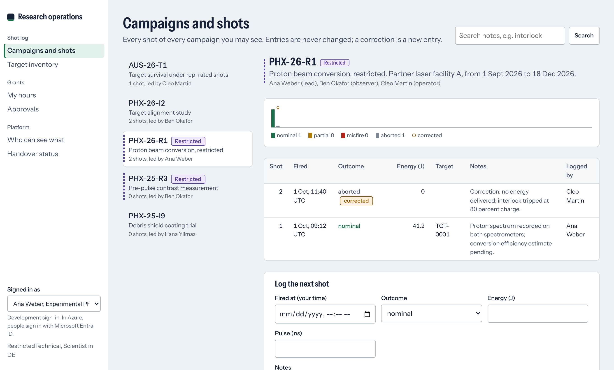

# research-ops-platform

**One TypeScript platform for the internal apps of a laser-fusion company: sign-in with Microsoft Entra ID,
one access model that PostgreSQL enforces row by row and that is proven for every person and job, and a
handover gate that an app must pass before its long-term owner takes it.**

Two apps run on it. A **shot log and target inventory** for laser campaigns, where restricted technical data
never appears to someone without clearance: not in lists, search results or counts. And **grant time and
cost reporting** for public funding, where people record hours as they go, grant leads approve them, and
Finance gets each month's eligible personnel costs per grant, while executives see a total only when it covers
enough people that it is not somebody's pay.



## Results

Generated by the code in this repository (`pnpm test`, `pnpm proof`, `pnpm handover`, `pnpm e2e`, `pnpm heldout`):

| | |
|---|---|
| **Access proof** | 13 principals (10 people, 3 scheduled jobs) × 15 tables × select, insert, update, delete, including statements without a `WHERE`: **5,057 statements, 0 disagreements** between the database and the access model ([reports/access/proof.json](reports/access/proof.json)) |
| **Policy mutants** | every rule weakened in the plausible ways (removed, widened to all staff, one condition dropped): **109 of 111 caught**; the other 2 are listed as equivalent, with the reason a reviewer can check ([config/access_equivalent.yaml](config/access_equivalent.yaml)) |
| **Handover gate** | both apps **ready**: owner, runbook with every section, alerts wired to emitted metrics, **22 of 22 routes** called by a test, access proof current, migrations reversible, every column classified ([reports/handover](reports/handover)) |
| **Tests** | 80 server tests on real PostgreSQL (API, jobs, migrations, cost engine with property tests, infrastructure policy), 6 console unit tests, 12 end-to-end tests in Chromium with axe (WCAG 2.1 AA): all pass |
| **Blind sets, first runs** | written from the documents only by separate sessions, each run once before anything was changed: set 1 **40/40** cost and **163/173** access cases ([first run](reports/heldout/blind-1/first_run.json); six misses were the runner not knowing job identities, four were real); set 2, written after the fixes, **44/44** and **221/222** ([first run](reports/heldout/blind-2/first_run.json)) |

## What it solves

A software team that builds internal tools in a forward-deployed way joins a project, delivers, hands over and
moves on. That leaves three gaps:

1. **Access rules are written per app and drift.** Here they are written once, in
   [config/access.yaml](config/access.yaml), and generated into PostgreSQL row-level security, the Entra ID
   app roles of the API and [docs/ACCESS.md](docs/ACCESS.md). Every request and every scheduled job runs as its
   caller in one transaction ([ADR 1](docs/adr/0001-one-access-model.md)).
2. **Nobody can say who can actually see what.** A reference evaluator reads the same model and the access
   matrix compares it with the real database for every principal, table and operation; policy mutants prove the
   fixtures would notice a weakened rule ([ADR 2](docs/adr/0002-proof-by-matrix-and-mutants.md)).
3. **The next owner inherits an app, not an operation.** `pnpm handover <app>` refuses until the runbook,
   alerts, route tests, access proof and reversible migrations are there ([ADR 4](docs/adr/0004-handover-gate.md)).

## How it works

```
config/access.yaml ──► generator ──► PostgreSQL policies + grants ──┐   docs/ACCESS.md, Entra app roles (infra/)
        │                                                          ▼
        └──► reference evaluator ──► access matrix ◄── real database, as each of 13 principals ──► policy mutants
                                                                   ▲
Entra ID token ─► API (Fastify) ─► asPrincipal: one transaction, SET LOCAL identity, runtime role without BYPASSRLS
Azure Functions timers ─► jobs as service principals (cost snapshot, reminders, outbox dispatcher) ──┘
config/grants.yaml ─► packages/costs (year to date, by month) ─► Finance lines, snapshots, executive totals (n ≥ 3)
config/apps.yaml + runbooks + alerts ─► handover gate ─► reports/handover
```

| Area | What is here |
|---|---|
| **Monorepo** | pnpm workspaces: `packages/` (platform config, access model, db and migrations, auth, observability, cost engine) and `apps/` (API, jobs, web console), shared tooling (TypeScript strict, Biome, Vitest) |
| **Identity** | Microsoft Entra ID access tokens checked for signature, issuer, audience and lifetime (jose); app roles from the access model; application tokens and the service-only `Platform` role refused for people; a dev issuer for local runs and tests that the API refuses in production |
| **Data** | PostgreSQL 16; five migrations, each with a down step that restores the schema exactly (tested step by step); triggers keep the record's rules whoever writes: append-only shots, one shot per target, target lifecycle, closed months final, 10-hour daily limit under concurrency, a lead changes only the status of someone else's entry |
| **API** | Fastify 5 with zod schemas, RFC 9457 problem responses, request ids, OpenAPI generated from the routes ([docs/openapi.json](docs/openapi.json)), full-text search under row security, a hidden row answers 404 |
| **Money** | [docs/GRANT_RULES.md](docs/GRANT_RULES.md): EU daily rate (annual cost / 215, 215-day cap across grants) and German hourly cost basis (contract or actual hours, managing-director cap); late records kept but not charged; other entities' staff listed, not charged; year to date by month so twelve months add up to the cent ([ADR 3](docs/adr/0003-year-to-date-costs.md)) |
| **Jobs** | runtime-agnostic jobs run as service principals under row security; Azure Functions timer triggers in production; outbox with `SKIP LOCKED` delivery, retries and a dead limit |
| **Observability** | pino logs with token redaction; OpenTelemetry traces and metrics, exported to Application Insights in Azure; alert rules generated from [config/alerts.yaml](config/alerts.yaml) |
| **Infrastructure** | OpenTofu for Azure: private PostgreSQL Flexible Server with Entra-only sign-in, managed identities and no database password anywhere, Container Apps, Functions Flex Consumption, Key Vault with RBAC, Static Web Apps, alerts; policy tests run locally, `tofu validate` in CI |
| **Console** | React 19, Motion, TanStack Query; feature folders; design tokens only; every screen with a skeleton, an error with retry and an empty state; axe in the end-to-end tests |

## Run it

```bash
pnpm install
scripts/db.sh up && export ROP_DATABASE_URL=postgres://postgres@127.0.0.1:55432/rop
pnpm migrate && pnpm seed && pnpm job cost-snapshot
AUTH_MODE=dev pnpm dev:api        # http://localhost:8080
pnpm dev:web                      # http://localhost:5173: choose a person in the sidebar
pnpm test && pnpm proof && pnpm handover
```

A 15-minute tour of the code is in [docs/WALKTHROUGH.md](docs/WALKTHROUGH.md); runbooks are in
[docs/runbooks](docs/runbooks).

## What building it found

- **PostgreSQL skips SELECT policies for an UPDATE without a `WHERE` clause.** A rule that let every member of
  staff update targets was invisible to tests that update one row by id, because the SELECT policy hid the row
  first. The policy mutants survived until the matrix also tried statements without `WHERE`.
- **PostgreSQL may combine one rule's USING with another rule's CHECK.** A lead could have approved their own
  draft hours through the owner's rule if the lead rule's "not your own" condition were missing from its CHECK; a
  mutant and a fixture row (a lead's own draft) now hold that line.
- **Fixtures need people whose situation changed.** To catch every mutant the fixture gained a person who moved
  from the lab to Legal but still leads an old campaign, a scientist whose clearance lapsed, and a US employee on
  a German grant: real cases a hand-written test list had missed.
- **The blind writer found three rules the database did not hold.** Quarter hours and the reason for returning an
  entry were enforced by the API only, and changing the entity of a personnel cost record was silently ignored.
  Migration 0004 fixed all three; the set became a regression set
  ([heldout/blind-1/STUDIED.md](heldout/blind-1/STUDIED.md)) and a second blind set was written from the
  updated documents.
- **The second blind writer found a gap the proof could not.** A campaign lead whose clearance had lapsed could
  declassify their own restricted campaign with an `UPDATE` without `WHERE`, because the rule checked clearance on
  the new row only. The proof compares the database with the model, and the model allowed it; a reader of the
  documents spotted it. The rule now checks the existing row too
  ([heldout/blind-2/STUDIED.md](heldout/blind-2/STUDIED.md)).
- **A total over two people is their pay.** Executive reporting now withholds totals over fewer than three
  contributors, by row security on the snapshot table rather than by the screen.

## Limits

- **Not deployed.** The OpenTofu code passes local policy tests and `tofu validate` in CI; no Azure environment
  has been applied. Sign-in with real Entra ID tokens (`AUTH_MODE=entra`, MSAL in the console) is written but
  only the dev issuer has run.
- **Reminder e-mail is not sent.** Notifications go to the outbox and the dispatcher; the Microsoft Graph
  adapter is not implemented.
- **The grant rules model two methods** and are not legal advice; each grant's agreement decides. Totals over
  three or more people can still be differenced across months; the minimum group size reduces, not removes,
  that risk.
- **The proof is as good as the model and the fixtures.** It shows the database does what `config/access.yaml`
  says; whether the model says the right thing is for its owners and the blind sets (the second one found a
  rule that was wrong in the model itself). Two of 111 mutants are accepted as equivalent by argument, not by
  test.
- **Both blind sets are now regression sets**; no fresh blind set has been run after the last fixes.
- **The blind sets were written by separate Claude sessions given only the documents**, not by people.
